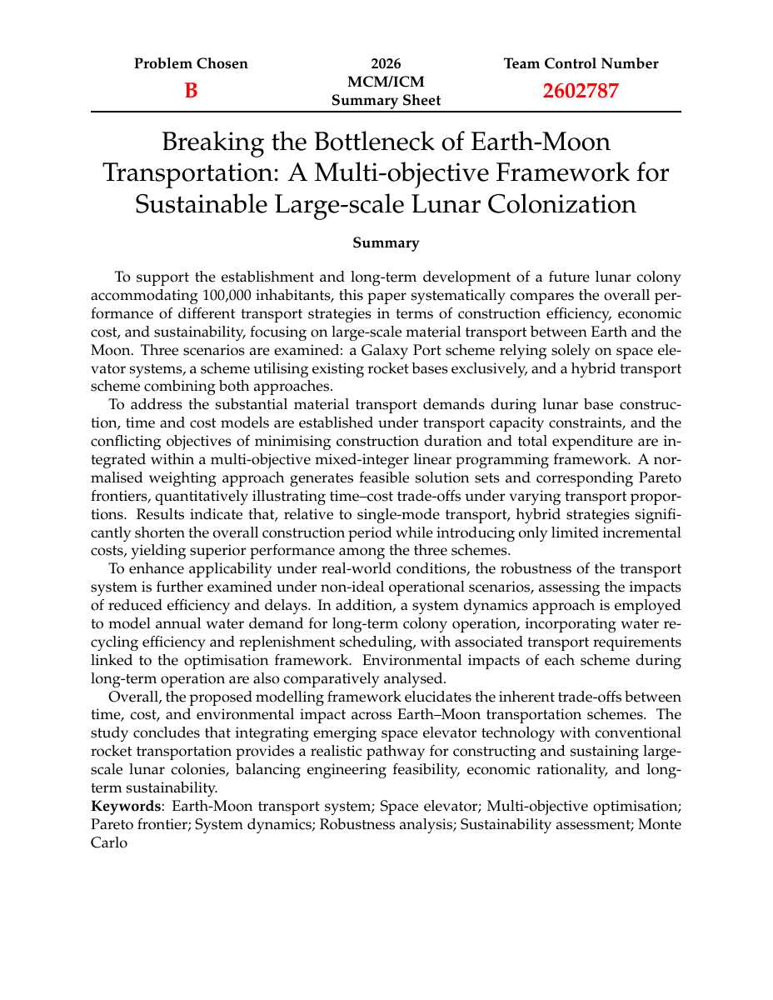
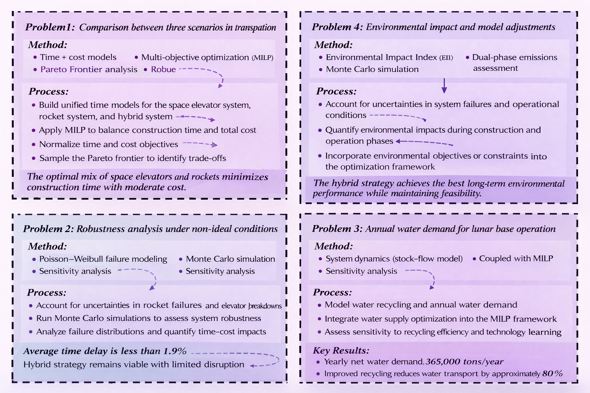
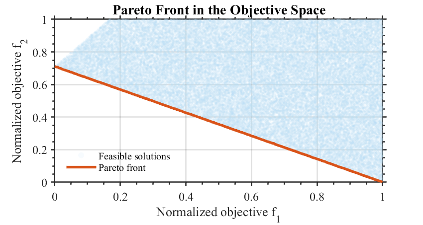

# Earth–Moon Transportation Optimization

**2026 MCM · Problem B | 地月运输方案优化与月球基地可持续运营**

面向一个容纳 **100,000 人**的月球基地，如何将 **1 亿吨**建设物资从地球运到月球，并在工期、成本和运行风险之间作出选择？本项目比较太空电梯、传统火箭与混合运输三种方案，使用多目标优化与蒙特卡洛模拟分析运输决策，并在论文中进一步讨论水资源循环和环境影响。

*A mathematical modeling project comparing space elevators, rockets, and hybrid Earth–Moon logistics through time–cost optimization and stochastic reliability simulation.*

[阅读论文 PDF](paper/paper.pdf) · [LaTeX 源码](paper/paper.tex) · [模型与结果](docs/MODELS.md) · [运行指南](docs/REPRODUCIBILITY.md) · [历史版本](archive/README.md)

<a href="paper/paper.pdf"></a>



## 项目亮点

- **运输决策建模**：统一比较三种运输策略，结合运力约束、目标归一化和权重分析，展示时间与成本的取舍。
- **随机风险模拟**：使用泊松故障计数与混合 Weibull 延误分布，评估非理想运行条件下的成本和工期。
- **结果解释与可视化**：通过 Pareto 前沿、成本构成、相关性和敏感性图表解释方案差异。
- **长期运营分析**：论文将水循环补给和环境影响纳入运输方案讨论。

**技术栈**：MATLAB · Optimization Toolbox · Statistics and Machine Learning Toolbox · LaTeX

## 主要结果

以下为[原论文“三种方案比较”表](paper/paper.tex)中的建模结果，基于比赛设定与模型假设；本次仓库整理未重新运行 MATLAB 验证这些数值。

| 运输策略 | 完成时间（年） | 总成本（USD） |
| --- | ---: | ---: |
| 仅太空电梯 | 186.22 | 6.01725 × 10¹³ |
| 仅传统火箭 | 456.62 | 4.867 × 10¹³ |
| 混合运输 | 132.44 | 5.689 × 10¹³ |

原报告中的混合方案相较仅太空电梯缩短工期约 **28.9%**，相较仅火箭缩短约 **71.0%**；对应的成本高于仅火箭方案。结果用于说明模型内的决策取舍。

| 时间与成本的取舍 | 非理想运行条件下的模拟分布 |
| :---: | :---: |
|  |  |

## 从哪里开始

| 想了解的内容 | 入口 |
| --- | --- |
| 完整研究思路、假设与结论 | [论文 PDF](paper/paper.pdf) · [LaTeX 源码](paper/paper.tex) |
| 理想条件下的时间与成本权衡 | [Q1 混合运输模型](code/q1_tradeoff.m) |
| 故障与延误影响 | [Q2 随机模拟模型](code/q2_robustness.m) |
| 环境要求、运行方式与输出 | [运行与复现说明](docs/REPRODUCIBILITY.md) |
| 模型对应关系与已知限制 | [模型说明](docs/MODELS.md) |
| 参数推导过程及旧版草稿 | [历史归档](archive/README.md) |
| 团队协作约定 | [贡献说明](docs/CONTRIBUTING.md) |

## 快速运行

在 MATLAB 中将当前目录设为仓库根目录，然后执行以下命令。建议先阅读[完整运行指南](docs/REPRODUCIBILITY.md)：脚本默认采样规模较大，Pareto 筛选可能耗时较长。

```matlab
project_root = pwd;
addpath(fullfile(project_root, 'code'));
if ~isfolder('outputs'), mkdir('outputs'); end
cd('outputs');
q1_tradeoff                  % 运行 Q1；运行 Q2 时改为 q2_robustness
```

两个入口都保留竞赛原始算法。Q1 需要 Optimization Toolbox；Q2 需要 Statistics and Machine Learning Toolbox，且脚本中间包含局部函数，建议使用 MATLAB R2024a 或更新版本。当前没有经过本仓库验证的 MATLAB 版本或自动化数值测试。

## 仓库结构

```text
MCM2026/
├── README.md               # 作品集入口
├── code/                   # 两个主要 MATLAB 模型
├── paper/                  # 英文论文 PDF、LaTeX 源码与 AI 使用报告
├── figure/                 # 原报告图表及设计素材
├── docs/                   # 模型、复现、协作说明与参考材料
├── data/                   # 输入数据说明
└── archive/                # 旧版代码、章节与参数推导草稿
```

## 项目说明

这是美赛团队项目的代码与写作材料整理。水资源与环境分析目前以论文和已有图表形式保存，仓库未包含对应的独立生成脚本；图表也未全部建立自动生成流程。旧版材料保留在归档中，参数与单位可能与主论文不同，使用前请查阅[已知限制](docs/MODELS.md#已知限制)。

仓库保留 [AI 使用报告](paper/AIreport.tex)。当前未附开源许可证；第三方参考材料的权利归原作者所有。
